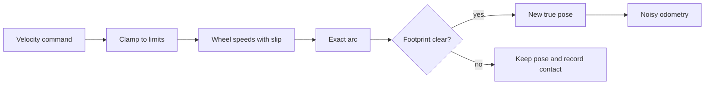

# Differential drive and odometry

## Intuition

The robot has two independently driven wheels. Equal wheel speeds move it straight, and opposite speeds turn it in place. Any other pair moves it along a circular arc.

The simulator keeps the true pose. Odometry starts from the same motion and adds noise, so its estimate drifts farther from the truth as the robot moves.



## Math

For command speed `v`, turn rate `w` and wheel base `b`:

```text
left  = (v - w b / 2) (1 - min(|N(0, slip_sigma)|, 1))
right = (v + w b / 2) (1 - min(|N(0, slip_sigma)|, 1))
v_actual = (left + right) / 2
w_actual = (right - left) / b
```

For a nonzero turn rate over time `dt`:

```text
theta' = theta + w_actual dt
x' = x + (v_actual / w_actual) (sin theta' - sin theta)
y' = y - (v_actual / w_actual) (cos theta' - cos theta)
```

A move is blocked when the round footprint overlaps an occupied cell or leaves the map. One continuous contact counts as one collision.

Odometry measures the true distance `d` and turn `a` for the tick:

```text
d_measured = d + N(0, trans |d|)
a_measured = a + N(0, rot |a|)
```

It then moves along the estimated heading plus half of the measured turn.

## Parameters

| Parameter           | Default   | Effect of increasing it                              |
| ------------------- | --------- | ---------------------------------------------------- |
| `wheel_base_m`      | 0.4 m     | The same turn rate needs more wheel speed difference |
| `radius_m`          | 0.25 m    | The robot needs wider aisles                         |
| `max_v`             | 1.0 m/s   | The robot can travel faster                          |
| `max_omega`         | 1.5 rad/s | The robot can turn faster                            |
| `slip_sigma`        | 0         | Wheels lose more commanded speed                     |
| `wheel_noise.trans` | Rig       | Distance estimates drift faster                      |
| `wheel_noise.rot`   | Rig       | Heading estimates drift faster                       |

## Code and source

The code is in [`drive.py`](../../core/src/gridbot_core/sim/drive.py) and [`odometry.py`](../../core/src/gridbot_core/sim/odometry.py). Chapter 5 of _Probabilistic Robotics_ by Thrun, Burgard and Fox covers velocity and odometry motion models.
