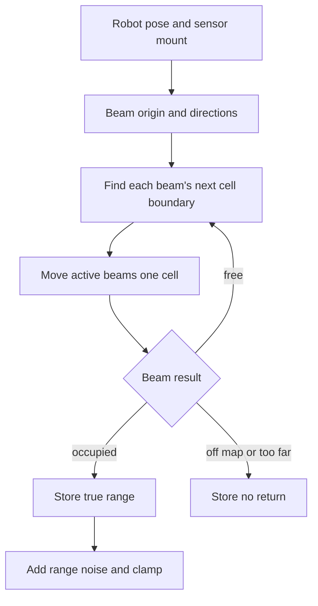

# Lidar ray casting

## Intuition

A 2D lidar sends out beams and reports how far each one travels before it reaches an obstacle. In a grid map, a beam can visit only the cells along its line, so the simulator walks from one cell boundary to the next until it hits an occupied cell, leaves the map or passes the sensor's maximum range.

Python would be too slow if it handled each beam and cell separately. Gridbot keeps all unfinished beams in NumPy arrays and advances them together.



## Math

For beam direction `(dx, dy)`, cell size `s` and origin position `p` on an axis:

```text
next boundary distance = (boundary - p) / d
boundary spacing       = s / |d|
```

At each step, a beam crosses whichever axis boundary is closer. The crossing distance becomes its range if the new cell is occupied.

A full 360 degree scan spaces beams by `fov / beams`, which avoids measuring the same direction twice. A narrower scan spaces them by `fov / (beams - 1)`, so both edge beams are included.

Measured hits use `true range + N(0, noise_sigma_m)`, clamped between 0.05 m and `range_m`. Beams with no return stay at infinity.

## Parameters

| Parameter       | Effect of increasing it                  |
| --------------- | ---------------------------------------- |
| `fov_deg`       | The scan covers a wider angle            |
| `beams`         | Angular detail and compute cost increase |
| `range_m`       | Farther obstacles can be seen            |
| `noise_sigma_m` | Hit distances become less precise        |
| `mount`         | The scan origin and direction change     |

## Code and source

The code is in [`lidar.py`](../../core/src/gridbot_core/sensors/lidar.py). The traversal follows Amanatides and Woo, "A Fast Voxel Traversal Algorithm for Ray Tracing" (1987).
